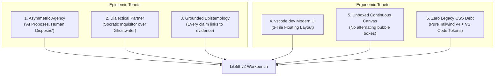

# LitSift v2: Architectural Blueprint & Development Guide

> **The Dialectical Literature Review & Epistemic Synthesis Workbench**  
> *Combining the visual elegance of the vscode.dev Modern 3-Tile UI with the epistemic rigor of Dialectic.*

---

## 1. Executive Summary & Vision

**LitSift v2** is a ground-up reimagining of LitSift, built directly on the UI/UX philosophy, design system, and workbench architecture of [discoveraniket/dialectic](https://github.com/discoveraniket/dialectic).

### The Core Problem LitSift Solves
Traditional literature review tools treat research papers as isolated static PDFs and reduce extraction to either manual spreadsheet transcription or uncontrolled generative "summaries". Researchers end up stranded between clunky reference managers (Zotero, Mendeley) and loose chatbot conversations that hallucinate claims and silently drift from the source text.

### The LitSift v2 Solution
LitSift v2 models literature synthesis as an **interactive, local-first epistemic workbench**:
- **Source-Grounded Extraction**: Extracted claims, methodologies, and findings are directly linked to exact coordinates (bounding boxes, page numbers, text quotes) in the source PDFs.
- **Asymmetric Agency ("AI Proposes, Human Disposes")**: The agent never unilaterally mutates project tables or tags. Extractions are staged as structured pull-request-style diff cards for explicit researcher approval.
- **Socratic Thinking Partner**: Instead of generating passive summaries, the AI probes unexamined assumptions, identifies methodological gaps, and detects statistical anomalies across papers.
- **High-Density 3-Tile Workbench**: A distraction-free, IDE-grade workspace based on **Visual Studio Code for the Web (`vscode.dev`)** with dockable panels, scooped tabs, and 60fps resizer sashes.

---

## 2. Core UI/UX Philosophies (Adopted from Dialectic)

LitSift v2 is governed by four non-negotiable architectural tenets:



### 1. Visual Studio Code for the Web (`vscode.dev`) Modern UI (3-Tile Layout)
- **Canvas Backdrop**: Unified `#1f1f1f` with 4px outer margins (`p-1`).
- **TitleBar (`35px`)**: Seamless `#1f1f1f` header with LitSift mark, `<` `>` history nav, Command Center Search (`Ctrl+P` quick-open for papers/claims/tabs), and free-standing layout toggles (`PanelLeft`, `PanelBottom`, `PanelRight`).
- **Tile 1 (Unified Left Tile)**: Encapsulates both the 48px Activity Bar and Primary Explorer inside a single floating card (`rounded-lg border border-[#2b2b2b] bg-[#181818] overflow-hidden`).
- **Tile 2 (Center Tile)**: Encapsulates Scooped Concave Tabs, Breadcrumbs bar (`22px`), Central Viewer (PDF Reader / Article Reader / Master Data Grid / Workspace Hub / Discovery), and a docked Bottom Panel with a horizontal Monaco sash.
- **Tile 3 (Right Tile / Auxiliary Bar)**: Encapsulates the Dialectical Agent Timeline with leftward free expansion and full center maximization (`[ ]` button).
- **Inter-tile Sashes**: Thin 4px gaps with 3-dot resize indicators; highlights with `#0078d4` line on hover/drag. Double-clicking the right sash snaps Tile 3 to 50% width.
- **StatusBar (`22px`)**: Seamless `#1f1f1f` footer without top divider, remote badge (`>< Web / Local`), active paper indicators, table row counters, and telemetry stats.

### 2. Asymmetric Agency ("AI Proposes, Human Disposes")
- The AI agent is strictly an **advisory and extraction intelligence**, never an autonomous project mutator.
- When an agent extracts variables, findings, or sample sizes from a paper, it outputs a **Staged Proposal Card**:
  - Displays diff lines: additions (`+` emerald highlight) and subtractions (`-` rose highlight).
  - Explicit action buttons: `[ Accept into Grid ]` commits the data to Dexie/AG Grid; `[ Reject ]` dismisses it.
  - The human researcher remains the sovereign supervisor of all project knowledge.

### 3. Dialectical Partner over Ghostwriter
- The agent does not simply generate generic paragraphs. It acts as an adversarial scientific peer:
  - Surfaces **Socratic Inquisitor Follow-Up Chips** (e.g. `[ Probe Methodology ]`, `[ Compare Sample Sizes ]`, `[ Audit Statistical Power ]`).
  - Emits multi-part diagnostic questionnaires (`ActiveInquiryForm`) when research parameters are ambiguous.
  - Surfaces a collapsible **Epistemic Reasoning Disclosure** (`Thought for 1.8s >`) detailing its chain-of-thought analysis.

### 4. Unboxed Continuous Action Canvas
- Replaces legacy chat bubble containers (`ml-4`, `mr-2`, rounded bubble wrappers) with a **continuous unboxed stream** on `#181818`.
- Includes:
  - **Tool Execution Step Badges**: Rounded pills `[ >_ extract:metadata ]`, `[ search:semantic_scholar ]` with execution durations.
  - **Context Mention Pills**: `@paper:vaswani2017`, `@cell:sample_size`, `@claim:attention_mechanism`.
  - **Telemetry Strip**: Latency (TTFT), generation speed (tok/s), context size, and total time.
  - **Floating Prompt Card**: Anchored at the bottom with 4 free-standing unboxed buttons (`+` Add Context, Model selector popover, Configuration, and Send).

---

## 3. Technology Stack & Tooling

LitSift v2 uses a strictly modern, zero-legacy-baggage stack:

```
├── Framework:            React 19 (Native actions, useOptimistic, concurrent rendering)
├── Language:             TypeScript 5.7+ (Strict static typing, zero `any` policy for domain models)
├── Bundler & Dev Server: Vite 6+ (Instant HMR, native ES modules, Rollup build)
├── Styling Engine:       Tailwind CSS v4 (@tailwindcss/vite with Lightning CSS in Rust)
├── Icons:                Lucide React (lucide-react)
├── Data Grid:            AG Grid Community (ag-grid-react, ag-grid-community v36+)
├── Document Rendering:   PDF.js (pdfjs-dist v4+) with dedicated Web Worker
├── Math Notation:        KaTeX (katex, @types/katex) for inline and block equations
├── Local Database:       Dexie.js v4 (IndexedDB with typed reactive tables)
└── State Management:     Zustand v5 + Immer (Fine-grained reactive subscriptions)
```

---

## 4. Architectural Directory Blueprint

```
LitSift_v2/
├── public/
│   ├── litsift-logo.svg
│   └── pdf.worker.min.mjs                  # Dedicated local PDF.js worker
├── src/
│   ├── main.tsx                            # Bootstrap entry
│   ├── App.tsx                             # Store hydration gate & root layout mount
│   ├── index.css                           # Tailwind v4 import & VS Code Monaco styles
│   │
│   ├── config/
│   │   ├── models.ts                       # Gemini, OpenRouter, LM Studio provider config
│   │   └── version.ts                      # App version & build metadata
│   │
│   ├── db/
│   │   └── litsiftDb.ts                    # Dexie IndexedDB schemas (papers, rows, schemas)
│   │
│   ├── types/
│   │   ├── layout.ts                       # 3-Tile workbench types, tabs, sash state
│   │   ├── paper.ts                        # Paper metadata, text spans, citations, bboxes
│   │   ├── grid.ts                         # Table columns, cells, review statuses
│   │   ├── agent.ts                        # Turns, tool steps, proposals, telemetry
│   │   └── extraction.ts                   # Extraction schemas, prompts, batch jobs
│   │
│   ├── store/
│   │   ├── usePdfStore.ts                  # Papers library, active PDF, highlight spans
│   │   ├── useGridStore.ts                 # Master grid rows, columns, pending reviews
│   │   ├── useAgentStore.ts                # Timeline turns, active tool steps, proposals
│   │   └── useLayoutStore.ts               # Tile sizes, collapsed states, active tabs
│   │
│   ├── services/
│   │   ├── pdfUtils.ts                     # PDF text extraction & bounding box mapping
│   │   ├── extractionEngine.ts             # Micro-agentic cell & column extraction
│   │   ├── batchExtractionRunner.ts        # Parallel paper processing queue
│   │   ├── academicSearchService.ts        # Semantic Scholar, arXiv, OpenAlex search
│   │   ├── doiService.ts                   # DOI resolving & Crossref metadata fetcher
│   │   ├── csvImportService.ts             # CSV parsing & schema reconciliation
│   │   ├── smartContextWindowing.ts        # Token-optimized context pruning
│   │   ├── highlightUtils.ts               # Text matching & DOM selection to PDF coords
│   │   └── geminiService.ts                # Streaming Gemini API client with tool-calling
│   │
│   ├── utils/
│   │   ├── markdownRenderer.tsx            # Formatted Markdown + KaTeX LaTeX equations
│   │   └── formatters.ts                   # Date, file size, token count formatters
│   │
│   └── components/
│       ├── brand/
│       │   └── LitSiftLogo.tsx             # Scalable SVG brand mark
│       │
│       ├── layout/
│       │   ├── TitleBar.tsx                # 35px TitleBar with Command Center & toggles
│       │   ├── ActivityBar.tsx             # 48px VS Code Activity Bar with menu button
│       │   ├── PrimarySideBar.tsx          # Left Explorer (Papers, Discovery, Schemas)
│       │   ├── EditorTabStrip.tsx          # Scooped concave fillet tab bar
│       │   ├── EditorBreadcrumbs.tsx       # 22px navigation breadcrumb bar
│       │   ├── BottomPanel.tsx             # Docked Tile 2 panel (Data Grid + Telemetry)
│       │   ├── AgentTelemetryConsole.tsx   # Real-time event log inspector
│       │   ├── StatusBar.tsx               # 22px seamless footer
│       │   └── WorkspaceLayout.tsx         # Root 3-Tile floating layout orchestrator
│       │
│       ├── pdf-viewer/
│       │   ├── CentralViewerPanel.tsx      # Tab router (PDF, Article, Grid, Hub, Settings)
│       │   ├── PdfReader.tsx               # PDF.js canvas, text layer, highlight layer
│       │   └── ArticleReaderView.tsx       # Distraction-free Markdown text reader
│       │
│       ├── data-grid/
│       │   ├── AgGridWrapper.tsx           # Virtualized AG Grid with custom cell renderers
│       │   ├── BottomGridPanel.tsx         # Docked bottom grid container
│       │   ├── MasterGridView.tsx          # Full-canvas master spreadsheet tab
│       │   └── CsvSchemaMapperModal.tsx    # Column alignment dialog for CSV import
│       │
│       ├── agent/
│       │   ├── RightAgentPanel.tsx         # Host for unboxed timeline & prompt box
│       │   ├── AgentTimelineStream.tsx     # Continuous timeline canvas (no bubbles)
│       │   ├── UserTurnItem.tsx            # Researcher prompt with @context pills
│       │   ├── AgentTurnItem.tsx           # Structured response with tools & proposals
│       │   ├── StagedProposalCard.tsx      # "AI Proposes, Human Disposes" diff cards
│       │   ├── SocraticInquiryGroup.tsx    # Follow-up branching chips
│       │   ├── ActiveInquiryForm.tsx       # Diagnostic questionnaire form
│       │   ├── ToolExecutionBadge.tsx      # Tool execution badges with duration
│       │   ├── ReasoningDisclosure.tsx     # Collapsible chain-of-thought drawer
│       │   ├── PerformanceMetricsBar.tsx   # TTFT, tok/s, context tokens strip
│       │   ├── ModelSelectorPopover.tsx    # VS Code style model switcher
│       │   └── AgentChatInput.tsx          # 4-button floating prompt card
│       │
│       └── navigation/
│           └── CommandPaletteModal.tsx     # Ctrl+P fuzzy search modal
│
├── index.html                              # HTML shell
├── package.json                            # Scripts & dependencies
├── vite.config.ts                          # Vite + Tailwind v4 + Gemini bridge
└── tsconfig.json                           # Strict TypeScript configuration
```

---

## 5. Domain Data Models

```typescript
// --- 1. RESEARCH PAPER PRIMITIVES ---
export interface Paper {
  id: string;
  name: string;
  fileBlob?: Blob;
  pdfDataUri?: string;
  doi?: string;
  authors?: string[];
  year?: number;
  abstract?: string;
  pageCount: number;
  addedAt: number;
  extractedTextByPage?: Record<number, string>;
  evidenceHighlights?: EvidenceHighlight[];
}

export interface EvidenceHighlight {
  id: string;
  paperId: string;
  pageNumber: number;
  snippetQuote: string;
  sectionName?: string;
  color?: string;
  boundingBox?: { x1: number; y1: number; x2: number; y2: number };
}

// --- 2. EXTRACTION GRID PRIMITIVES ---
export interface GridColumn {
  field: string;
  headerName: string;
  type: 'text' | 'number' | 'category' | 'boolean' | 'citation';
  description?: string;
  extractionPrompt?: string;
}

export interface GridRow {
  id: string;
  paperId: string;
  paperTitle: string;
  cells: Record<string, CellValue>;
}

export interface CellValue {
  value: string | number | boolean;
  status: 'draft' | 'pending_review' | 'confirmed' | 'rejected';
  confidenceScore?: number;
  evidenceQuote?: string;
  pageNumber?: number;
}

// --- 3. AGENTIC & DIALECTICAL PRIMITIVES ---
export interface ToolStep {
  id: string;
  label: string;             // e.g. "extract:metadata", "search:pubmed"
  iconType: 'terminal' | 'search' | 'tool' | 'code' | 'bolt';
  durationText?: string;     // e.g. "Worked for 1.8s"
  status: 'completed' | 'running' | 'error';
  command?: string;
  output?: string;
}

export interface DiffLine {
  type: 'add' | 'remove' | 'context';
  text: string;
}

export interface StagedProposal {
  id: string;
  title: string;             // e.g. "Extracted Methodology & Sample Size"
  targetColumnField?: string;
  targetPaperId?: string;
  diffLines: DiffLine[];
  payload: {
    columnField: string;
    paperId: string;
    extractedValue: string;
    evidenceQuote?: string;
    pageNumber?: number;
  };
  status?: 'pending' | 'accepted' | 'rejected';
}

export interface UserTurn {
  id: string;
  kind: 'user';
  prompt: string;
  timestamp: number;
  contextPills?: Array<{ id: string; label: string; icon?: 'file' | 'claim' | 'paper' | 'tag' }>;
}

export interface AgentTurn {
  id: string;
  kind: 'agent';
  timestamp: number;
  status: 'idle' | 'executing' | 'streaming' | 'complete' | 'error';
  toolSteps?: ToolStep[];
  reasoning?: { thinking: string; durationText?: string };
  content: string;
  proposals?: StagedProposal[];
  followUpChips?: string[];
  metrics?: {
    ttftMs?: number;
    totalTimeMs?: number;
    tokensPerSec?: number;
    contextTokens?: number;
    totalTokens?: number;
  };
  error?: string;
}

export type TimelineTurn = UserTurn | AgentTurn;
```

---

## 6. Phased Implementation Roadmap

```mermaid
gantt
    title LitSift v2 Implementation Sequence
    dateFormat  X
    axisFormat %s

    section Phase 1: Workbench Shell
    Scaffold Vite + React 19 + Tailwind v4 :0, 2
    TitleBar & 3-Tile Floating Layout      :2, 4
    Scooped Tabs & Monaco Sashes           :4, 6

    section Phase 2: Persistence & Stores
    Port Dexie DB & Hydration Layer        :6, 8
    usePdfStore, useGridStore, useAgentStore:8, 10

    section Phase 3: Center Viewer
    PDF.js Reader & Article Reader         :10, 13
    Highlight Coordinates & Sync           :13, 15

    section Phase 4: Docked Data Grid
    AG Grid Virtualized Integration        :15, 18
    Tile 2 Bottom Panel (Grid + Telemetry) :18, 20

    section Phase 5: Dialectical Agent
    Unboxed Action Timeline Stream         :20, 23
    Staged Proposal Cards ("AI Proposes")  :23, 26
    Socratic Follow-Up Chips & Prompt Box  :26, 28

    section Phase 6: Explorer & Discovery
    Left Explorer: Papers, DOI, Hub        :28, 30
    Command Center (Ctrl+P) Palette        :30, 32
```

### Phase 1: Workbench Shell & 3-Tile Floating Architecture
- Bootstrap project with Vite, React 19, TypeScript, and `@tailwindcss/vite`.
- Implement `TitleBar` (`35px`) with logo, history buttons, Command Center search box, and panel toggles.
- Implement `WorkspaceLayout` orchestrating Tile 1 (Left), Tile 2 (Center), and Tile 3 (Right) with 4px sashes.
- Implement `EditorTabStrip` with signature scooped concave fillet curves.
- Implement `StatusBar` (`22px`).

### Phase 2: Persistence & Store Layer
- Port `db/litsiftDb.ts` from LitSift_local to maintain 100% schema compatibility with existing user databases.
- Port `usePdfStore.ts`, `useGridStore.ts`, and `useAgentStore.ts` with Zustand v5 and IndexedDB hydration.

### Phase 3: Center Tile — Central Viewer
- Port `CentralViewerPanel.tsx`, `PdfReader.tsx`, and `ArticleReaderView.tsx`.
- Configure dedicated `pdf.worker.min.mjs` in public directory.
- Verify PDF zoom, text selection, and evidence quote highlighting.

### Phase 4: Center Tile — Docked Bottom Data Grid
- Port `AgGridWrapper.tsx` and `BottomGridPanel.tsx`.
- Dock AG Grid into the bottom of Tile 2 with horizontal Monaco sash resizer.
- Add tabs in Bottom Panel to switch between **Data Grid** and **Agent Telemetry Console**.

### Phase 5: Right Tile — Dialectical Agent Timeline
- Port Dialectic's unboxed continuous stream (`AgentTimelineStream.tsx`, `UserTurnItem.tsx`, `AgentTurnItem.tsx`).
- Port **`StagedProposalCard.tsx`** for "AI Proposes, Human Disposes" extraction reviews.
- Wire Gemini function-calling with `ToolExecutionBadge`, `ReasoningDisclosure`, and `SocraticInquiryGroup`.
- Build the 4-button floating prompt card (`AgentChatInput.tsx`) with `ModelSelectorPopover`.

### Phase 6: Left Tile — Paper Explorer & Ingest
- Port `LeftExplorerPanel.tsx` (Paper library, DOI search modal, author enrichment, workspace backup hub).
- Implement `CommandPaletteModal.tsx` (`Ctrl+P`) for instantaneous keyboard-driven navigation across papers, tabs, and actions.

---

## 7. Migration Matrix (LitSift_local -> LitSift_v2)

| File in `LitSift_local` | Action in `LitSift_v2` | Migration Notes |
| :--- | :--- | :--- |
| `src/styles/theme.css` | **REPLACE** | Replace 1,820 lines of legacy CSS with Tailwind v4 + VS Code Modern CSS variables. |
| `src/components/layout/WorkspaceLayout.tsx` | **REWRITE** | Replace legacy full-bleed divs with Dialectic's clean 3-Tile floating card layout. |
| `src/components/layout/HeaderBar.tsx` | **SPLIT** | Split into top `TitleBar.tsx` (35px) and Tile 2's `EditorTabStrip.tsx` (scooped tabs). |
| `src/components/agent/RightAgentPanel.tsx` | **REWRITE** | Replace chat bubble boxes with Dialectic's unboxed continuous action timeline. |
| `src/db/litsiftDb.ts` | **PORT AS-IS** | Zero schema changes; preserves IndexedDB compatibility. |
| `src/store/*.ts` | **PORT & CLEAN** | Port Zustand stores; strip out dead layout hacks and UI patch flags. |
| `src/services/pdfUtils.ts` | **PORT AS-IS** | High-value pure calculation utilities; port directly. |
| `src/services/extractionEngine.ts` | **ENHANCE** | Update extraction outputs to emit `StagedProposal` diffs rather than direct row mutations. |
| `src/services/academicSearchService.ts`| **PORT AS-IS** | Clean pure API client for Semantic Scholar, arXiv, and OpenAlex. |
| `src/components/pdf-viewer/*` | **PORT & POLISH** | Re-mount inside Tile 2's scooped editor canvas. |
| `src/components/data-grid/*` | **PORT & POLISH** | Re-mount inside Tile 2's docked bottom panel. |

---

## 8. Developer Quickstart Guide

### 1. Initialize LitSift v2 Repository
```powershell
cd d:\Codes\GitHub\asma-workspace\LitSift_v2
npm init -y
```

### 2. Install Core Dependencies
```powershell
npm install react@^19.0.0 react-dom@^19.0.0 lucide-react@^1.16.0 zustand@^5.0.3 immer@^10.1.1 dexie@^4.4.5 ag-grid-react@^36.1.0 ag-grid-community@^36.1.0 pdfjs-dist@^4.10.38 katex@^0.19.0 marked@^18.0.9 dompurify@^3.4.14 clsx@^2.1.1 tailwind-merge@^3.0.1
```

### 3. Install Developer Tooling & Tailwind v4
```powershell
npm install -D vite@^6.1.0 @vitejs/plugin-react@^4.3.4 tailwindcss@^4.3.3 @tailwindcss/vite@^4.3.3 typescript@^5.7.3 @types/react@^19.0.8 @types/react-dom@^19.0.3 @types/katex@^0.16.8 @types/dompurify@^3.0.5 vitest@^5.0.3
```

### 4. Development & Build Commands
- **Start Dev Server**: `npm run dev`
- **Type Check**: `npx tsc --noEmit`
- **Run Unit Tests**: `npm test`
- **Build Production Bundle**: `npm run build`
